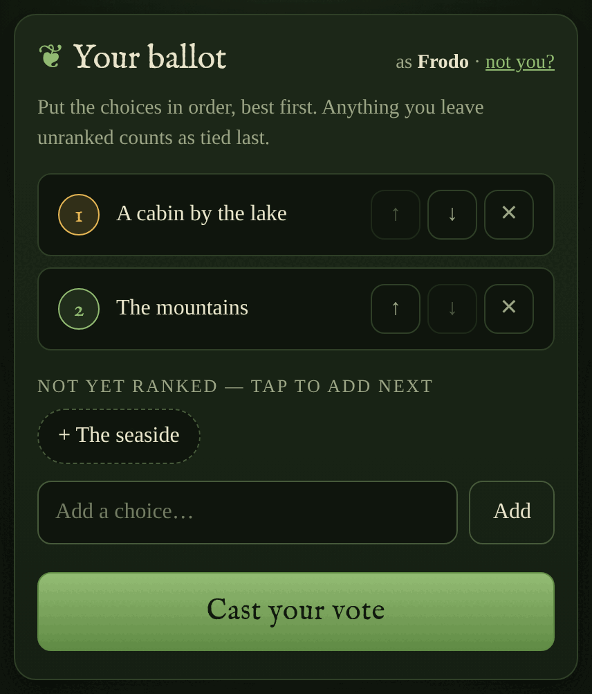
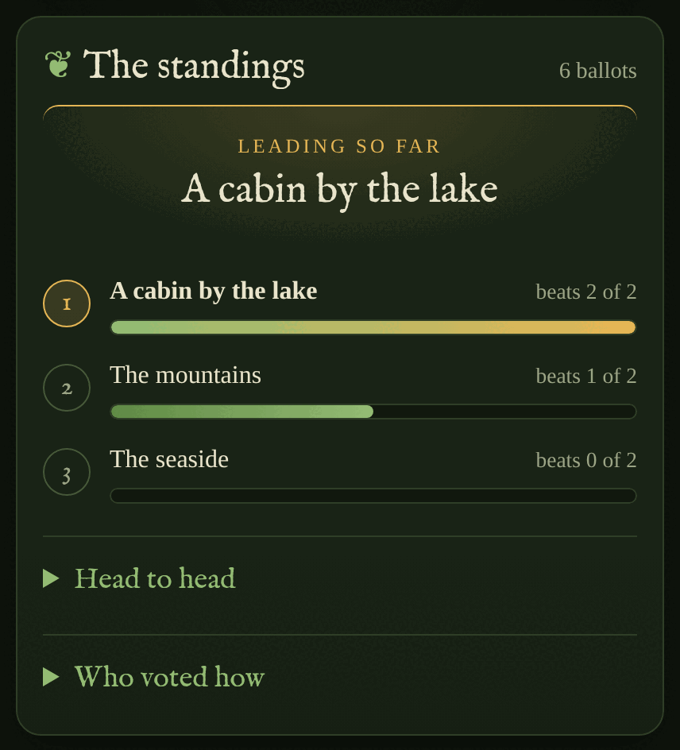

# 🌳 Entmoot

A small, account-free group decision tool. One person calls a moot (a question plus a set of
options), shares the link, and everyone else votes. Like the real Entmoot, the deliberation can
take as long as it needs, but it ends in a decision.

It is a sibling of [Sign To Erebor](../sign_to_erebor) and follows the same model: share a link,
type your name, no sign-up.

| Voting (ranked) | The standings |
|---|---|
|  |  |

The home page has a built-in illustrated guide: **What is this?** (also reachable at `/#guide`).

## How it works

### Calling a moot
The creator sets up:

- **The question and its options**, e.g. *"Where do we go for the May weekend?"*
- **The voting method**:
  - **Approval**: tick every option you'd be happy with. Most ticks wins.
  - **Ranked**: order the options from best to worst. The winner is computed with the
    **Schulze method** (Condorcet-consistent, resistant to tactical voting).
  - **Score**: rate each option (e.g. 0–5). Highest total wins.
- **Open options**: whether participants may add their own options.
- **Ballot visibility**:
  - *public*: everyone can see who voted how;
  - *secret*: everyone can see who has voted, but not how.

After creating the moot, the creator gets two links:

- the **moot link** to share with participants;
- the **admin link** (keep it private), used to close the moot.

### Voting
- A participant enters a name, plus an optional password that protects their ballot, and casts
  a vote.
- **Results are hidden until you have voted**, so nobody is swayed by the current standings.
- A ballot can be **changed until the moot is closed**. Rejoining with the same name restores
  your previous ballot. Identity is also remembered per browser.
- The page polls periodically, so new votes appear without a refresh.

### Closing
- The creator closes the moot from the admin link (the creator's browser also remembers it). After that, ballots are frozen and the final
  results are visible to everyone.
- Ranked moots show the final ranking and the **pairwise matrix**
  (*"A beats B 5–3"*), so the result can be explained.

## Run

```sh
node server.js        # or: npm start
# → http://localhost:3000
npm test              # counting logic + API tests (node --test)
```

There are no dependencies: plain Node (built-in `http`) and a vanilla JS frontend. Data is
persisted to `data.json` next to the server. `PORT` and `DATA_FILE` can be overridden with
environment variables.

The page has two themes, *Fangorn by night* (dark) and *Derndingle by morning* (light). It
follows the system preference, can be switched from the top bar, and can be forced with
`?theme=light` / `?theme=dark`.

## Project layout

```
entmoot/
├── server.js        HTTP server: static files + JSON API, persistence to data.json
├── lib/
│   └── tally.js     Pure vote-counting functions (approval, score, Schulze)
├── public/
│   ├── index.html   Single-page shell
│   ├── app.js       Frontend (create moot / vote / results views)
│   ├── style.css    Themes: light and dark
│   ├── fonts/       IM Fell English (SIL Open Font License)
│   └── img/         Screenshots for the “What is this?” guide (light + dark)
└── test/
    ├── tally.test.js  Tests for the counting logic
    └── api.test.js    Tests for the HTTP API
```

## API

| Method | Path                              | Purpose                                              |
|--------|-----------------------------------|------------------------------------------------------|
| POST   | `/api/moots`                      | Create a moot. Returns `{ id, adminToken }`          |
| GET    | `/api/moots/:id`                  | Moot info. Results only for voters or once closed    |
| POST   | `/api/moots/:id/join`             | Join with name (+ password). Returns a voter token   |
| PUT    | `/api/moots/:id/ballot`           | Cast or replace your ballot (requires voter token)   |
| POST   | `/api/moots/:id/options`          | Add an option (open options, or the creator)         |
| DELETE | `/api/moots/:id/options/:option`  | Remove an option (requires admin token)              |
| POST   | `/api/moots/:id/close`            | Close the moot (requires admin token)                |

The voter token travels as `Authorization: Bearer <token>`, the admin token as
`X-Admin-Token: <token>`. Ballot bodies are `{ ballot: { approved: [ids] } }`,
`{ ballot: { ranking: [ids] } }` or `{ ballot: { scores: { id: 0–5 } } }`.

## Decisions

These were open questions in the first draft; this is how they are settled for now.

- **Peeking**: because results show after voting *and* ballots stay editable, someone can cast a
  throwaway vote, see the standings, then vote tactically. That is accepted among friends.
- **Expiry**: a closed moot is deleted 30 days after closing; an open one after 180 days without
  any activity. The sweep runs at start-up and then hourly.
- **Ties**: tied options share a rank (1, 1, 3). A tie at the top is shown as shared first
  place; there is no tie-break rule.
- **Option removal**: the creator can remove an option while the moot is open (at least two
  must remain). Ballots keep everything else and simply lose the removed option. Merging
  options is not supported.
